<a href="https://mostlygino.com">
  <picture>
    <source media="(max-width: 600px) and (prefers-color-scheme: dark)" srcset="assets/banner-dark-mobile.svg?v=456a18c8">
    <source media="(max-width: 600px)" srcset="assets/banner-light-mobile.svg?v=8e7a699e">
    <source media="(prefers-color-scheme: dark)" srcset="assets/banner-dark.svg?v=252c444d">
    
  </picture>
</a>

  <a href="#showreel"><picture><source media="(prefers-color-scheme: dark)" srcset="assets/cards/nav-showreel-dark.svg?v=00658dac"></picture></a>
  <a href="#more"><picture><source media="(prefers-color-scheme: dark)" srcset="assets/cards/nav-more-dark.svg?v=1fbdd4de"></picture></a>
  <a href="#contact"><picture><source media="(prefers-color-scheme: dark)" srcset="assets/cards/nav-contact-dark.svg?v=ee95491e"></picture></a>
  <a href="https://mostlygino.com"><picture><source media="(prefers-color-scheme: dark)" srcset="assets/cards/nav-site-dark.svg?v=dcf7d171"></picture></a>

  <a href="https://mostlygino.com"><picture><source media="(max-width: 600px) and (prefers-color-scheme: dark)" srcset="assets/cards/intro-mobile-dark.svg?v=e835f3f1"><source media="(max-width: 600px)" srcset="assets/cards/intro-mobile-light.svg?v=48e5a7c8"><source media="(prefers-color-scheme: dark)" srcset="assets/cards/intro-dark.svg?v=5453f3e1"></picture></a>

  <a href="#showreel"><picture><source media="(max-width: 600px) and (prefers-color-scheme: dark)" srcset="assets/cards/stats-mobile-dark.svg?v=14eabf76"><source media="(max-width: 600px)" srcset="assets/cards/stats-mobile-light.svg?v=6fb0ae7e"><source media="(prefers-color-scheme: dark)" srcset="assets/cards/stats-dark.svg?v=acc5b4c7"></picture></a>

 

## Showreel

  
  
  
  
  
  
  
  

  <picture>
    <source media="(max-width: 600px) and (prefers-color-scheme: dark)" srcset="assets/showreel-dark-mobile.svg?v=13efc67d">
    <source media="(max-width: 600px)" srcset="assets/showreel-light-mobile.svg?v=168752ef">
    <source media="(prefers-color-scheme: dark)" srcset="assets/showreel-dark.svg?v=99a0cbb6">
    
  </picture>

  <a href="https://mostlygino.com"><picture><source media="(prefers-color-scheme: dark)" srcset="assets/cards/project-mostlygino-dark.svg?v=b2acc86c"></picture></a>
  <a href="#contact"><picture><source media="(prefers-color-scheme: dark)" srcset="assets/cards/project-enma-dark.svg?v=efac5610"></picture></a>

  <a href="#contact"><picture><source media="(prefers-color-scheme: dark)" srcset="assets/cards/project-gravedigger-dark.svg?v=f6fd53a6"></picture></a>
  <a href="#contact"><picture><source media="(prefers-color-scheme: dark)" srcset="assets/cards/project-hettie-dark.svg?v=cfca8423"></picture></a>

  <a href="#contact"><picture><source media="(prefers-color-scheme: dark)" srcset="assets/cards/project-relay-dark.svg?v=c44eb360"></picture></a>
  <a href="#contact"><picture><source media="(prefers-color-scheme: dark)" srcset="assets/cards/project-tsukumo-dark.svg?v=3df20d62"></picture></a>

  <a href="https://github.com/mostlygino/Kuro"><picture><source media="(prefers-color-scheme: dark)" srcset="assets/cards/project-kuro-dark.svg?v=ab4aaf6a"></picture></a>
  <a href="#contact"><picture><source media="(prefers-color-scheme: dark)" srcset="assets/cards/project-onmitsu-dark.svg?v=fc2e83a1"></picture></a>

  <a href="#contact"><picture><source media="(prefers-color-scheme: dark)" srcset="assets/cards/project-shiru-dark.svg?v=4972b55e"></picture></a>

  <a href="#contact"><picture><source media="(max-width: 600px) and (prefers-color-scheme: dark)" srcset="assets/cards/footnote-mobile-dark.svg?v=91eb428a"><source media="(max-width: 600px)" srcset="assets/cards/footnote-mobile-light.svg?v=19c39720"><source media="(prefers-color-scheme: dark)" srcset="assets/cards/footnote-dark.svg?v=4100a6bc"></picture></a>

  <a href="#contact"><picture><source media="(prefers-color-scheme: dark)" srcset="assets/cards/principles-dark.svg?v=78698207"></picture></a>
  <a href="#contact"><picture><source media="(prefers-color-scheme: dark)" srcset="assets/cards/stories-dark.svg?v=7ab89902"></picture></a>

 

## More

  <a href="https://mostlygino.com"><picture><source media="(max-width: 600px) and (prefers-color-scheme: dark)" srcset="assets/cards/site-mobile-dark.svg?v=67d3f270"><source media="(max-width: 600px)" srcset="assets/cards/site-mobile-light.svg?v=31820d5a"><source media="(prefers-color-scheme: dark)" srcset="assets/cards/site-dark.svg?v=cfe40b38"></picture></a>

 

## Contact

  <a href="mailto:hello@mostlygino.com"><picture><source media="(max-width: 600px) and (prefers-color-scheme: dark)" srcset="assets/cards/contact-mobile-dark.svg?v=c0312947"><source media="(max-width: 600px)" srcset="assets/cards/contact-mobile-light.svg?v=8a5ef835"><source media="(prefers-color-scheme: dark)" srcset="assets/cards/contact-dark.svg?v=7a4ecc67"></picture></a>

  <a href="keys/hello.asc"><picture><source media="(prefers-color-scheme: dark)" srcset="assets/cards/key-hello-dark.svg?v=38ae3b1e"></picture></a>
  <a href="keys/security.asc"><picture><source media="(prefers-color-scheme: dark)" srcset="assets/cards/key-security-dark.svg?v=45ab75a7"></picture></a>

 

<a href="https://mostlygino.com">
  <picture>
    <source media="(max-width: 600px) and (prefers-color-scheme: dark)" srcset="https://raw.githubusercontent.com/mostlygino/mostlygino/main/assets/signoff/built-with-love-dark-mobile.svg?v=bdcb5510">
    <source media="(max-width: 600px)" srcset="https://raw.githubusercontent.com/mostlygino/mostlygino/main/assets/signoff/built-with-love-light-mobile.svg?v=bdcb5510">
    <source media="(prefers-color-scheme: dark)" srcset="https://raw.githubusercontent.com/mostlygino/mostlygino/main/assets/signoff/built-with-love-dark.svg?v=b9c22edb">
    
  </picture>
</a>

&copy; 2026 Gino. Icons, artwork, signature and code: all rights reserved. See <a href="LICENSE">LICENSE</a>.

